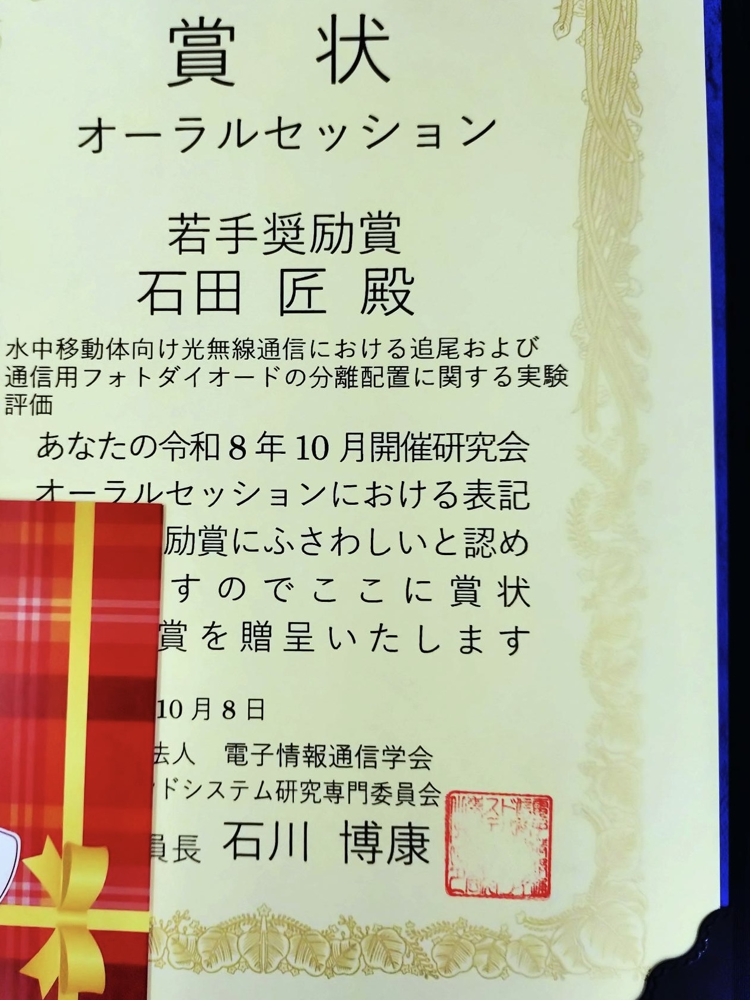

---
山里研D2の石田です．

この度，浜松市で開催されたWBS研究会にて，水中光無線通信における複数フォトダイオードによる追尾・通信性能の改善について発表いたしました．発表後の質疑応答では多くの貴重なご意見をいただき，自身の研究を見つめ直すとともに，今後の方向性を考える上で大変有益な機会となりました．

さらに，表彰式では若手奨励賞をいただくことができ，大変光栄に思います．このような賞をいただけたのも，ひとえにご指導いただいている山里先生，岡田先生，そして日頃から活発な議論を交わしてくれる研究室の皆様の支えがあってこそです．この場を借りて心より御礼申し上げます．

また，本研究会では自身の専門分野だけでなく，様々な分野の研究に触れることができ，参加者の皆様との議論を通じて大きな刺激を受けました．この貴重な経験を糧に，今後一層研究に精進してまいります．

---

<!-- ## タイトル無しの画像を埋め込む -->

